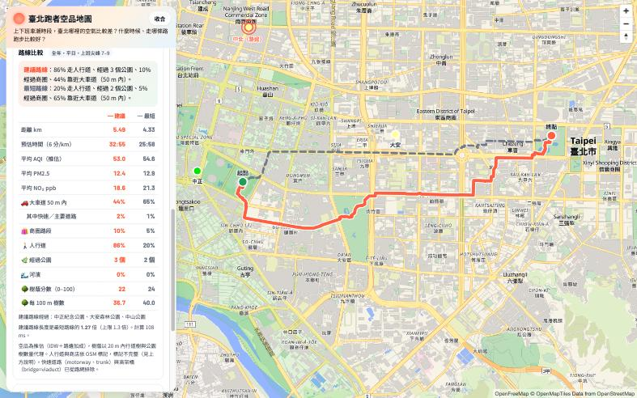

# 臺北跑者空品地圖

跑者出門前，選時段、平日或假日、季節，就能看到臺北各地的空氣品質。也可以畫自己的路線，或讓系統依偏好規劃一條空氣較好、遠離大馬路的路線，並和最短路線比較。

> 研究問題：上下班車潮時段，臺北各地的空氣品質是否比離峰差？平日與假日差多少？這會怎麼影響跑步時間與路線的選擇？



## 怎麼開

- **線上版**：https://bonniech9203.github.io/taipei-run-map/ （GitHub Pages，main 分支；每個階段驗收通過後才更新）

- **直接雙擊 `index.html`**：資料用 `<script>` 載入 `data/web/*.js`，不需要伺服器。但需要網路，才能載入 MapLibre（unpkg）、底圖（OpenFreeMap liberty）和字體（Google Fonts）。
  - 這個方式還沒在 file:// 下實測過，見 QA。
- 或在專案資料夾執行下面的指令，再開 http://localhost:8000：

```bash
python3 -m http.server 8000
```

## 介面

面板上方是共用的情境：**時段、日子、季節、指標**。下方分成三個分頁。手機上面板改成底部抽屜，按「收合」或拖曳把手，地圖就能全螢幕。

### 1. 空品地圖

| 控制 | 選項 | 地圖上會變什麼 |
|---|---|---|
| 時段 | 清晨 5–7／上班 7–9／中午 11–13／下班 17–19／夜間 19–22 | 測站、行政區、網格的顏色和圖例 |
| 日子 | 平日／假日 | 同上 |
| 季節 | 全年／冬 12–2／春 3–5／夏 6–8／秋 9–11 | 同上 |
| 指標 | AQI／NO₂／PM2.5／O₃ | 同上 |
| 行政區 | 全市或 12 區 | 縮放到該區；面板顯示 5 時段 × 平日／假日長條圖，以及「尖峰比離峰高幾 %」 |
| 面量顯示 | 行政區／500 m 網格 | 推估面的粒度 |
| 圖層開關 | 交通站（路邊）、公園、幹道 | 顯示或隱藏 |

- **AQI 顏色**：採環境部官方分級色（良好綠、普通黃、對敏感族群不健康橘、對所有族群不健康紅、非常不健康紫、危害褐紅）。一年平均值大多在 35–70，所以同一級內再用深淺區分。
- **NO₂、PM2.5、O₃**：用非官方的連續色階，只表示相對高低。
- **建議先看 NO₂**：AQI 是移動平均，各時段只差約 3–10；NO₂ 最能反映車潮（中北站平日清晨 16.1 ppb、下班尖峰 34.2 ppb）。

### 2. 畫路線（階段一）

1. 按「開始畫線」，在地圖上逐點點擊。
   - 「復原上一點」退一點，「清除」重畫。
   - **雙擊**或按「結束」完成。
2. 面板會顯示：
   - 長度、預估時間（配速預設 6 分鐘／公里，可以改）。
   - 平均 AQI、PM2.5、NO₂（推估）。
   - 兩側 20 m 內的樹木數、經過公園的比例、離大車道 50 m 內的比例。
   - **同一條路線在 5 個時段的長條圖**：綠色 ★ 是最好的時段，紅色 ▼ 是最差的時段。
3. 路線每 50 m 一段，依目前指標著色。點某一段可以看該段的推估值。
4. 「匯出 GeoJSON」下載 `my_route.geojson`；「匯入」可以讀回 LineString 或 MultiLineString。

### 3. 規劃路線（階段二）

1. 第一次打開這個分頁時，才載入步行路網（`network.js`，9.4 MB）。本機實測下載 342 ms、建立索引 431 ms。
2. 按「① 點地圖設起點」再點地圖，按「② 點地圖設終點」再點地圖。點的位置會吸附到最近的可跑道路。
3. 六個偏好拉桿，0＝關，1–5＝很低到很高：

   | 類別 | 偏好 | 怎麼判斷 |
   |---|---|---|
   | 避開 | 🚗 大車道 | 離 OSM motorway/trunk/primary/secondary 越近越貴（200 m 外不計） |
   | 避開 | 🛍️ 商圈 | 在 landuse=commercial/retail 內、或 50 m 內 shop 點多 |
   | 避開 | 💨 空污 | 所選情境的推估值：背景 IDW ＋ 路邊加成 |
   | 偏好 | 🚶 人行道 | highway=footway/pedestrian，或有 sidewalk=yes/both/left/right/separate、footway=sidewalk 標記 |
   | 偏好 | 🌿 公園與河濱 | 在公園內（OSM 公園面或公園點等面積圓），或距河流水域 ≤ 100 m、或公園名稱含「河濱」 |
   | 偏好 | 🌳 樹蔭 | 兩側 20 m 內的行道樹與公園樹數量 |

4. **建議路線長度上限**：預設最多是最短路線的 **1.3 倍**（使用者確認，可以改）。超過時，程式會自動降低偏好強度到剛好符合上限，並在畫面上註明。
5. 地圖上：建議路線是**珊瑚橘實線**，最短路線是**灰色虛線**。
6. 面板會顯示一句摘要，例如「86% 走人行道、經過 3 個公園、10% 經過商圈、44% 靠近大車道」。下面是兩條路線逐項比較的表：距離、時間、平均 AQI、PM2.5、NO₂、大車道、商圈、人行道、公園數、河濱、樹蔭分數。

## 資料來源與授權

| 資料 | 來源 | 授權 | 資料時間 | 座標系 | 用途 |
|---|---|---|---|---|---|
| 空氣品質逐時資料（12 自動測站：AQI、O3、PM2.5、PM10、CO、SO2、NO2） | 臺北市政府環境保護局（使用者下載的 12 個月 .ods） | 政府資料開放授權條款第 1 版（若確為臺北市資料大平臺資料） | 2025-11-01 00:00 – 2026-10-31 23:00 | — | 全部空品數值 |
| 臺北市空氣品質監測站基本資料 | 臺北市資料大平臺（環保局） | 政府資料開放授權條款第 1 版 | CSV 2021-09-13 | WGS84 | 測站位置 |
| 臺北市行政區界線 | 使用者提供 geojson | 依原始來源 | — | WGS84 | 行政區、路網範圍 |
| 115 年政府行政機關辦公日曆表 | 行政院人事行政總處（data.gov.tw 14718） | 政府資料開放授權條款第 1 版 | 2026 全年 | — | 2026 年假日判斷 |
| 行道樹、公園樹 | 臺北市資料大平臺 | 政府資料開放授權條款第 1 版 | 調查日至 2026-11-19 | EPSG:3826 → WGS84 | 樹蔭 |
| 臺北市公園基本資料（點＋面積） | 臺北市資料大平臺 | 政府資料開放授權條款第 1 版 | 無資料時間欄位 | WGS84 | 公園（等面積圓） |
| **OSM 步行路網、幹道、公園面、商業區、商店、河流水域**（路線規劃） | **© OpenStreetMap contributors**，經 Geofabrik `taiwan-261123.osm.pbf`（MD5 6983ef5b…）取得 | ODbL 1.0 | OSM 資料至 2026-11-23 | WGS84 | 階段二 |
| OSM 公園面、幹道（畫線分析、地圖圖層） | **© OpenStreetMap contributors**，經 Overpass（osmnx）取得 | ODbL 1.0 | 2026-11-24 下載 | WGS84 | 階段一 |
| 底圖 | OpenFreeMap liberty（© OpenMapTiles、**© OpenStreetMap contributors**） | ODbL | 即時 | Web Mercator | 底圖 |
| 電信信令人口 | 內政部 | 政府資料開放授權條款第 1 版 | 2020-11 | — | 目前未使用 |
| OSM 公開 GPS 軌跡 | api.openstreetmap.org | ODbL | — | — | ❌ 驗證不可用（篩出 0 段跑步） |
| 中央氣象署臺北站 466920 | — | — | — | — | ❌ **缺少** |

階段一和階段二的 OSM 圖資來源不同，原因是 2026-11-24 晚間 Overpass 主站和 4 個鏡像站都故障（回 502、504 或拒絕連線），階段二改用 Geofabrik 離線檔。兩者相差一天，差異應該很小，但沒有逐項比對。

### 公開散布的授權

- **OSM 衍生資料**：`data/web/network.js`、`parks.js`、`roads.js`、`osm_coverage.js` 是從 OpenStreetMap 衍生的資料庫，依 **ODbL 1.0** 散布。
  - 出處：© OpenStreetMap contributors。
  - 衍生資料必須沿用 ODbL。
- **政府開放資料**：`aq_data.js`、`trees.js`、`grid.js` 以政府資料開放授權條款第 1 版提供的資料為基礎。
- **程式碼**：授權尚未指定。

## OSM 資料完整度（不完整，畫面上也有註明）

詳見 [docs/osm_coverage.md](docs/osm_coverage.md)。

- **人行道**：車行道路共 2,033 km，標記「有人行道」的只占 **16.7%**，住宅巷道只有 8.2%。
  - 沒有標記不代表沒有人行道，只是沒人填寫。
  - 所以「偏好人行道」只會偏向「OSM 有標記的地方」，而這些地方多半是幹道旁的人行道。
- **商店**：臺北市內有 10,498 個 shop 點，各區密度差 32.6 倍（中正區每 km² 172.9 個、北投區 5.3 個）。
  - 一部分是真實差異，一部分可能是 OSM 志工標記程度不同。
  - 沒有官方商店點位可以比對，**無法算真正的覆蓋率**。

## 處理流程

1. **原始資料**：`data/raw/` 是從 `~/Desktop/台北市慢跑熱地圖` 複製過來的原始檔，原檔沒動。沒有位置的統計檔放在 `data/unused/`，理由寫在該資料夾的 README。
2. **`scripts/build_aq.py`**：讀 12 個 .ods，產生 `data/web/aq_data.js`。
   - 污染物 `-` 和 AQI=0 都當缺測（AQI=0 共 90 列，其中 55 列所有污染物都是 `-`）。
   - 時段含起點、不含終點。
   - 日子：2026 年依 115 年辦公日曆；**2025-11、12 月缺 114 年日曆，暫時只以週六日當假日**。
   - 有效小時少於 10 的格子輸出 null。目前 600 格全部有值。
   - 同時計算**路邊加成**（方法見下）。
3. **`scripts/build_grid.py`**：500 m 網格共 1,082 格，預先算好到 12 站的距離。
4. **`scripts/build_layers.py`**：畫線分析用的樹木點位、公園（OSM 面＋公園點等面積圓）、幹道。
5. **`scripts/osm_from_pbf.py`**：從 Geofabrik 臺灣檔切出臺北市的步行路網與相關圖資。
   - 步行道路的篩選照 osmnx 的 `walk` 規則：有 highway，area≠yes；highway 不含 abandoned、construction、corridor、elevator、escalator、motor…；foot≠no、service≠private、access≠private。
   - 在路口切段，路段兩端都在臺北市內才保留。
   - 和 osmnx 的差異：沒有把兩條路首尾相接處的節點合併，所以路段數較多（144,335 段，osmnx 版本是 116,931 段）。總長相近：5,793 km 對 5,306 km。
6. **`scripts/build_network.py`**：
   - 排除不適合跑步的道路：**motorway、trunk（含 _link，臺北的快速道路和多數高架橋），以及 bridge=viaduct**，共 614 段、約 118.9 km。
   - 只保留最大連通網路。
   - 替每段路計算：20 m 內樹數、公園編號、離快速／主要道路距離、離次要道路距離、人行道、商業區、50 m 內商店數、河濱。
   - 輸出 `data/web/network.js`（含路段形狀，簡化到約 2 m）。
7. **`scripts/osm_coverage.py`**：人行道與商店完整度，輸出 `docs/osm_coverage.md` 與 `data/web/osm_coverage.js`。

### 路邊加成（roadside increment）

一般站代表背景空氣，交通站設在路口，兩者的差就是跑在大馬路邊時多吸到的量。

1. **配對**：每個交通站配對 3 km 內的所有一般站：
   - 中北：大安、中正、延平。
   - 承德：延平、天母、大直。
   - 向陽：南港、內湖、信義。
2. **逐時相減**：同一小時，交通站值減去配對一般站的平均。
3. **依情境平均**：依季節、日子、時段分別平均，再取 3 個交通站的平均。

**怎麼套用到路線**：
- 推估值＝背景 IDW ＋ 路邊加成 × 距離係數。
- 距離係數：離幹道 50 m 內是 1，到 150 m 線性降為 0。這兩個距離是**假設值**，畫面上可以調整。
- 「幹道」**預設包含 motorway、trunk、primary、secondary**，可以切換成只算前三種。
  - 改預設的原因：臺北多數大馬路在 OSM 標為 secondary，包括信義路、仁愛路、南京東路、敦化南路、基隆路、新生南路、和平東路。只算 primary 會漏掉它們。
  - 民生東路、建國南路、市民大道平面段等標為 tertiary，目前**不算**幹道。

### 規劃路線的演算法（階段二）

- 成本＝路段長度 × (1 ＋ λ × 避開分數) ÷ (1 ＋ λ × 偏好分數)，用 Dijkstra 在瀏覽器內求解。
  - 避開分數：三項避開偏好的懲罰（0–1），乘上各自權重後相加。
  - 偏好分數：三項偏好的好處（0–1），乘上各自權重後相加。
- **偏好用「打折」，不用「懲罰沒有的路段」**：臺北大部分路段沒有人行道標記、不在公園、樹少。若用懲罰，幾乎每段路都一樣貴，偏好就會失效（實測：六項全開到 5 時，路線幾乎等於最短路線）。
- **空污懲罰在起終點周圍正規化**：範圍是起終點外框，向外延伸 1.5 km 或兩點距離的一半（取大者）。若用全市的最低到最高值換算，山區和市中心的背景差異會蓋過路邊加成，空氣偏好就失效（實測：空氣 5 時路線和最短路線完全相同）。
- **長度上限**：建議路線超過「最短路線 × 上限倍數」時，用二分法把 λ 從 1 往下調，最多 9 次，找出符合上限的最大 λ。

### 實測結果（平日上班尖峰，中正紀念堂 → 國父紀念館）

| 偏好 | 距離（倍數） | 大車道 50 m 內 | 平均 AQI | 平均 NO₂ | 人行道 |
|---|---|---|---|---|---|
| 全部關（＝最短路線） | 4.33 km | 65% | 54.6 | 21.3 | 20% |
| 空氣 5 | 4.93 km（1.14） | 22% | 52.3 | 17.1 | 32% |
| 大車道 5 | 5.56 km（1.28） | 19% | 52.0 | 16.5 | 34% |
| 預設（大車道 3、商圈 1、空氣 3、人行道 1、公園 2、樹蔭 1） | 5.49 km（1.27） | 44% | 53.0 | 18.6 | 86% |

**取捨**：「偏好人行道」「偏好樹蔭」單獨開時，會把路線拉向大馬路（人行道 5：靠近大車道 92%）。原因是 OSM 的人行道標記和行道樹多在幹道旁。所以建議和「避開大車道」或「避開空污」一起用。

## 推估與限制

- **所有空品數值都是推估**：一年平均＋IDW＋路邊加成，**不是即時或預報**。
- **IDW 只用 9 個一般站**（使用者決定）。北投、松山、萬華沒有測站。
- **路邊加成只來自 3 個大型路口的交通站**。距離衰減（50–150 m）是假設值；一般巷道的實際差異可能不同。
- 沒有氣象資料（466920 缺少），沒有考慮風向、降雨或逆溫。
- 沒有歷史車流量資料。「車潮造成空污」只能從 NO₂、CO 的時段差，以及交通站和一般站的差異間接推論。
- **OSM 人行道與商店標記不完整**（見上方完整度）。
- **樹蔭以樹木數量代理**：沒有樹冠大小、遮蔭方向，也沒有私有土地上的樹。
- 路網排除了 motorway、trunk 與 bridge=viaduct；一般跨河橋（如人車共用的 primary 橋）保留。
- 公園點換算成等面積圓，形狀不準，河濱公園多半要靠 OSM 公園面與河流水域判斷。

## 開發階段

| 階段 | 內容 | 狀態 |
|---|---|---|
| 必做 | 測站、各區 AQI、時段／日子／季節切換、路邊加成 | ✅ |
| 一 | 畫自己的路線 | ✅ 使用者已驗收 |
| 介面 | 明亮版（liberty 底圖、珊瑚橘、白卡片、手機抽屜） | ✅ 使用者已認可 |
| 二 | 自動規劃 A → B，六項偏好，建議路線 vs 最短路線 | ✅ 完成（長度上限 1.3 倍，使用者 2026-11-25 確認） |
| 三 | 環狀路線：起點＋目標距離，2–3 個選項，誤差 ±10% | ⏳ |
| 四 | 自己畫的路線 → 建議替代路線（起終點相同、空品更好） | ⏳ |

其他待辦：補上 114 年辦公日曆、氣象署 466920 逐時資料；熱門跑步區改用 Strava Metro。

## 檔案結構

```
index.html                  互動地圖
data/raw/                   原始檔（複製，不公開）；data/raw/osm/ 為 Geofabrik 離線檔
data/unused/                判定不用的檔案與理由
data/interim/               中間檔（不公開）
data/web/aq_data.js         測站情境平均、路邊加成
data/web/grid.js            網格與行政區
data/web/trees.js           樹木點位（約 3 MB）
data/web/parks.js           公園面與公園點等面積圓
data/web/roads.js           幹道
data/web/network.js         步行路網（9.4 MB，規劃分頁才載入）
data/web/osm_coverage.js    OSM 完整度數字
docs/01_data_validation.md  資料驗證報告
docs/osm_coverage.md        OSM 人行道與商店完整度
docs/screenshots/           畫面截圖
scripts/                    處理腳本
archive/v1/                 11/3 舊版作品（未刪除）
```

重建資料：

```bash
python3 -m venv .venv && .venv/bin/pip install pandas odfpy pyproj osmnx osmium tabulate
```

```bash
.venv/bin/python scripts/build_aq.py && .venv/bin/python scripts/build_grid.py && .venv/bin/python scripts/build_layers.py
```

```bash
curl -L -o data/raw/osm/taiwan-latest.osm.pbf https://download.geofabrik.de/asia/taiwan-latest.osm.pbf
```

```bash
.venv/bin/python scripts/osm_from_pbf.py data/raw/osm/taiwan-latest.osm.pbf && .venv/bin/python scripts/build_network.py && .venv/bin/python scripts/osm_coverage.py
```
